<div align="center">

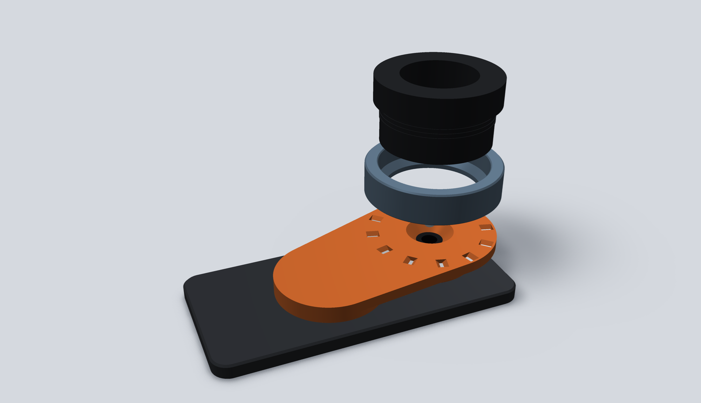

# Kestrel

**Snap-on magnetic digiscoping. Any scope, any phone, one click.**

A ring lives on your spotting scope's eyepiece. An adapter lives on your phone's MagSafe.<br>
Bring them together and three steel pins lying on the ring drop into V-grooves in the adapter, where magnets pull them in. The camera lands dead-centre on the eyepiece.

     

</div>

---

<table>
<tr>
<td width="55%">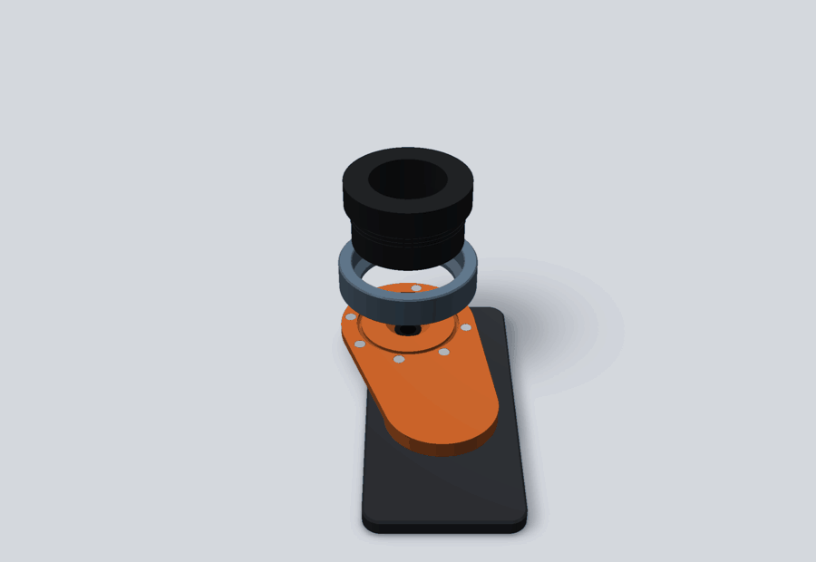</td>
<td>

### Why

Clamp adapters take a minute to line up, and you lose the bird while you do it. Kestrel splits the job in two:

- 🔭 **Ring** stays on the scope all day
- 📱 **Adapter** stays on the phone
- 🧲 **Click.** Three pins find three grooves and the magnets do the rest

Every ring fits every adapter, so one phone works on all your scopes, and one scope takes everyone's phone.

</td>
</tr>
</table>

## How it works

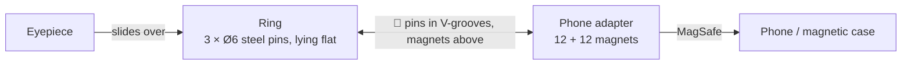

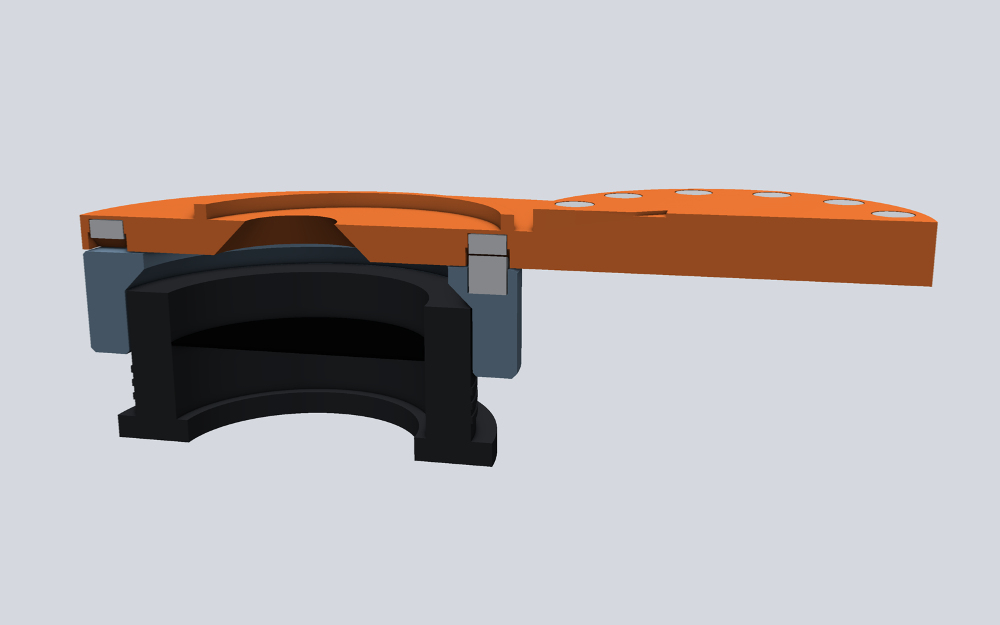

<sub>Section through the ATX eyepiece, the ring and the adapter, clicked together. A Ø6 steel pin lies radially in the ring and rests on both walls of a 90° V-groove in the adapter, 0.3 mm under a magnet sealed into the adapter. The 45° cone over the camera keeps the light path open and prints without supports.</sub>

| | |
|---|---|
| **Self-centring** | Kinematic coupling: 3 radial pins at 120° in 3 radial V-grooves fix every direction exactly once. A 0.3 mm offset or a 2° twist collides, so it can only sit centred and can't turn. |
| **Portrait or landscape** | 12 grooves, one every 30°. Lift, turn, click. |
| **Rotation lock** | On the OnePlus 13 a collar drops around the round camera island, so the hole can only land on the main camera. |
| **Universal interface** | Ball and groove circle Ø64.6 mm, ring OD 74 mm. Same on every part. |
| **Steel in the ring** | The ring holds three plain steel pins and the magnets live in the adapter. No magnets on your optics, and about 2 mT at the phone camera instead of 3.6 mT with magnets on both sides. |
| **Sealed magnets** | The printer pauses once and you drop the 12 coupling magnets in; the next layers close them in. No glue, nothing to fall out. |
| **Support-free** | No flat ceilings on any bed face: peaked grooves and 45° cones only. |

## The parts

<table>
<tr>
<td align="center" width="50%">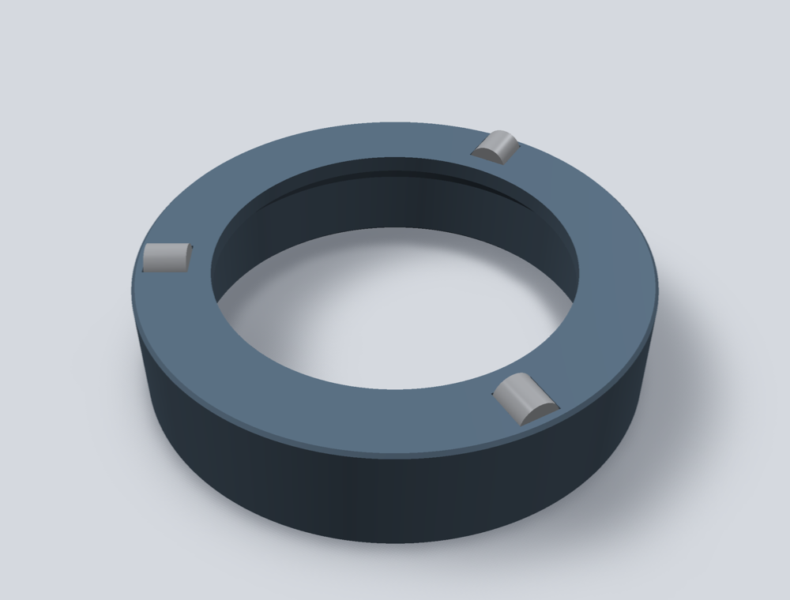<br><b>Ring: Swarovski ATX / STX</b><br><sub>Bore Ø59.7 for the Ø59 eyecup</sub></td>
<td align="center" width="50%">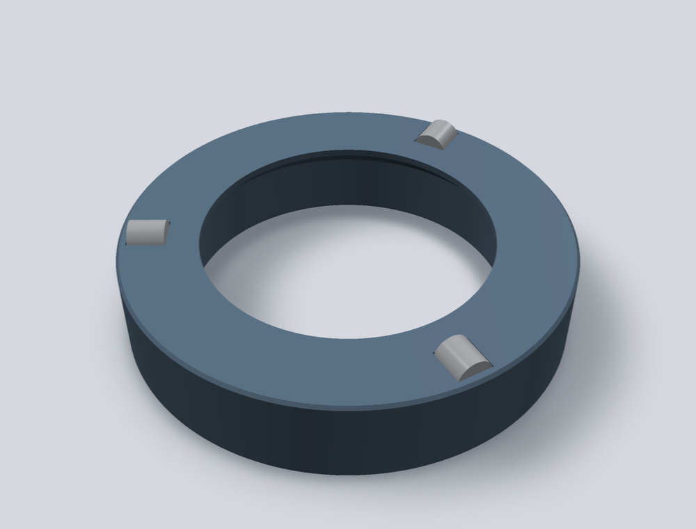<br><b>Ring: Vortex Diamondback HD 85</b><br><sub>Bore for the Ø53.4 eyepiece</sub></td>
</tr>
<tr>
<td align="center">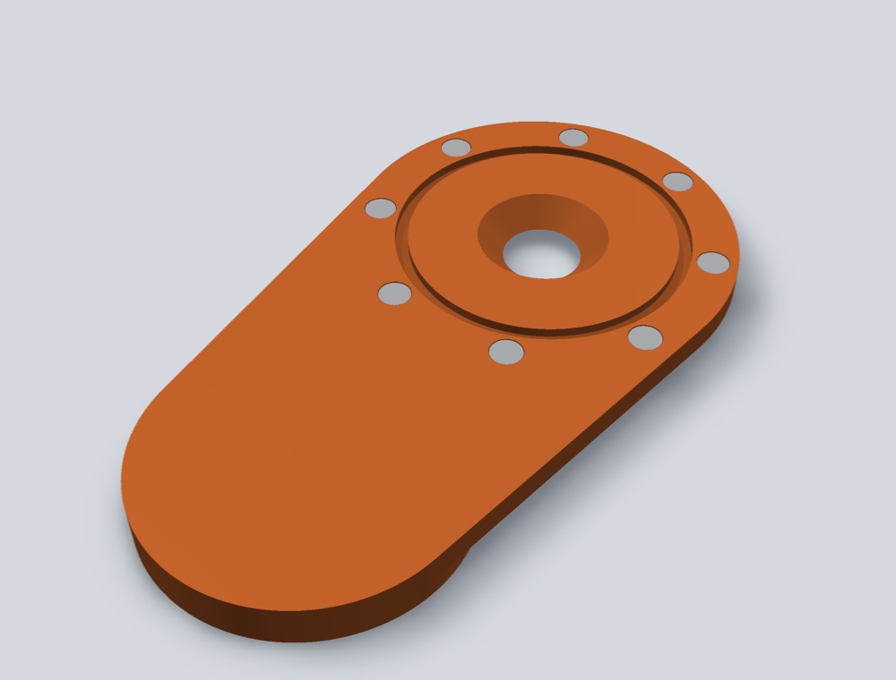<br><b>Adapter, scope side</b><br><sub>12 V-grooves with sealed magnets, 45° light cone</sub></td>
<td align="center">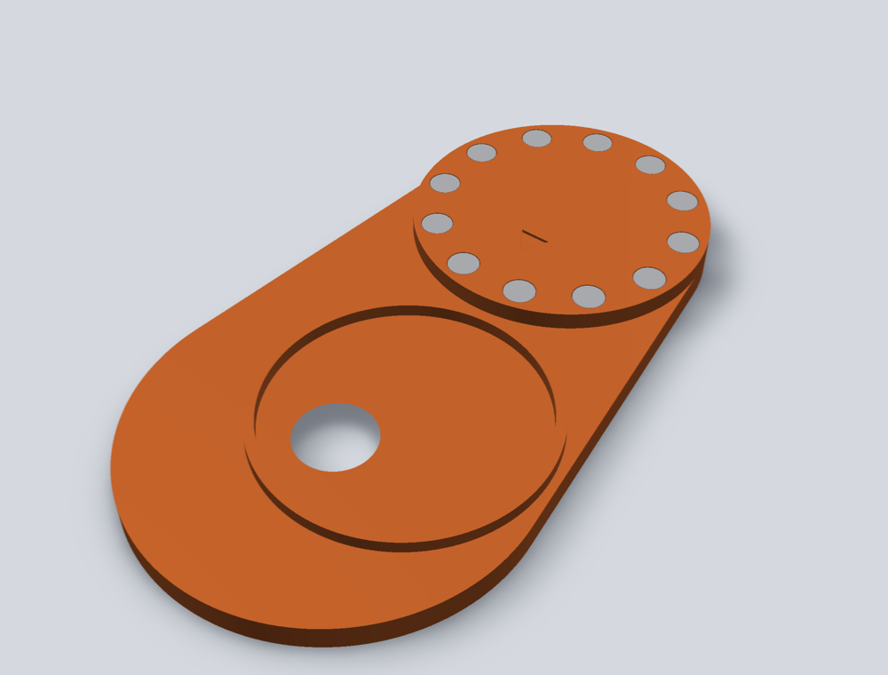<br><b>Adapter, phone side</b><br><sub>12-magnet MagSafe pad + collar for the camera island</sub></td>
</tr>
<tr>
<td align="center">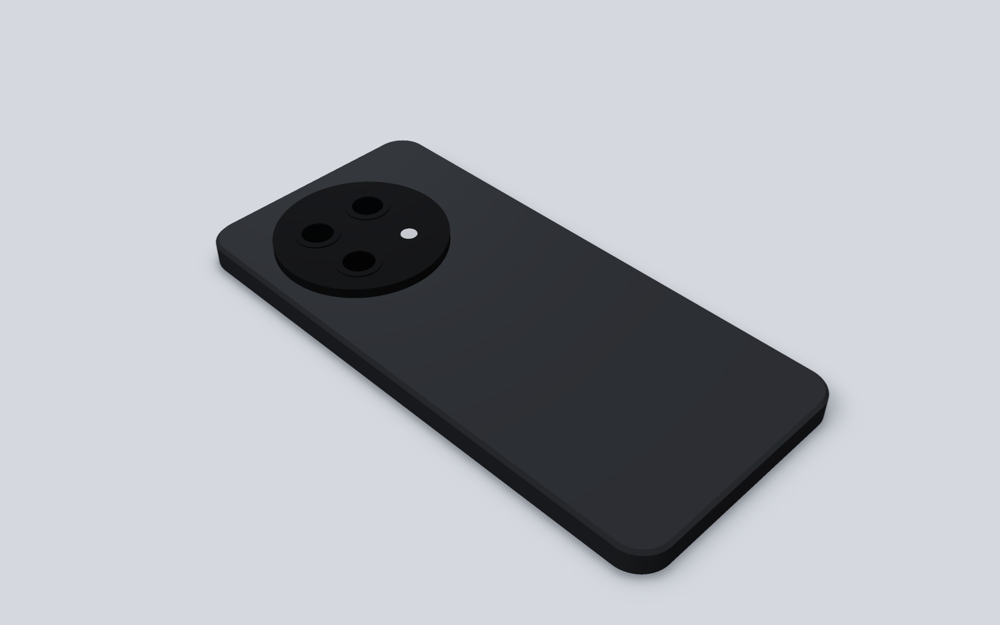<br><b>OnePlus 13 reference model</b><br><sub>Built from official dimensions + photo measurements</sub></td>
<td align="center">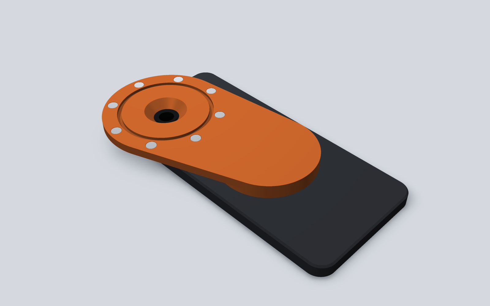<br><b>Adapter on the phone</b><br><sub>Hole on the main (top-left) camera, pad on MagSafe</sub></td>
</tr>
</table>

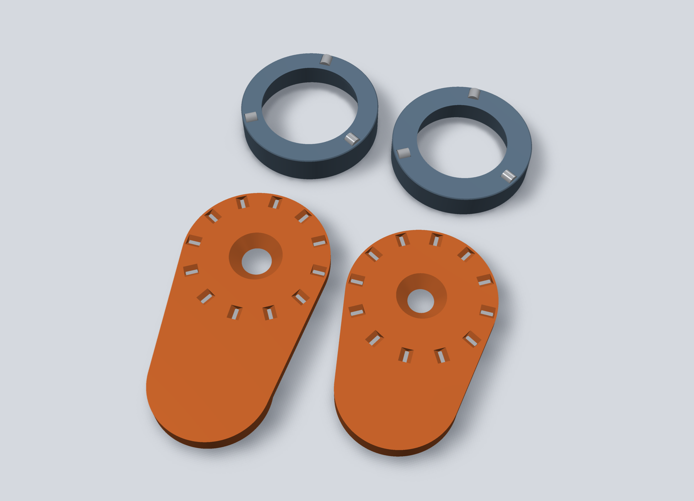

## Supported gear

| | Model | Key dimension | Source | STL |
|---|---|---|---|---|
| 🔭 | Swarovski ATX / STX | Eyecup Ø59 mm | Swarovski AR-S ring spec, Outdoorsmans 59 mm ring | [`okular_ring_ATX.stl`](okular_ring_ATX.stl) |
| 🔭 | Vortex Diamondback HD 20-60×85 | Eyepiece Ø53.42 mm | Vortex spec (2.103 in) | [`okular_ring_DiamondbackHD85.stl`](okular_ring_DiamondbackHD85.stl) |
| 📱 | OnePlus 13 + Sandstone Magnetic Case | MagSafe → main camera 68.4 mm | Official specs + photo; MagSafe centre measured on a Bizon magnetic case (Sandstone not yet confirmed) | [`telefon_adapter_OP13.stl`](telefon_adapter_OP13.stl) |
| 📱 | iPhone 15 | MagSafe → main camera 49.24 mm | Apple dimensional drawing | [`telefon_adapter_iPhone15.stl`](telefon_adapter_iPhone15.stl) |

> [!TIP]
> Click an STL above. GitHub shows it in an interactive 3D viewer.

## Build one

### 1. Buy

| Item | Qty |
|---|---|
| 6 × 3 mm N52 round magnets, axially magnetised | 24 per adapter (12 sealed in the grooves + 12 MagSafe) |
| Ø6 × 6 mm bearing-steel dowel pins (M6×6), e.g. [AliExpress 1005010026576161](https://www.aliexpress.com/item/1005010026576161.html) | 3 per ring. Must be magnetic, **not stainless 304**. Ø6 chrome-steel bearing balls work too (`ball_shape = "ball"`). Measure yours and set `ball_d` / `pin_len` in `digiscope.py` before printing |
| Superglue (CA) or 2-part epoxy | a few drops |
| Felt / flock tape | optional, if a ring sits loose |

### 2. Print

Ready-to-print files for a **Prusa MINI+ (Input Shaper)** are in [`print/`](print/):

| File | Contents | Time | Filament |
|---|---|---|---|
| `PLA_test_kobling.bgcode` | **Start here:** a thin ring top + the adapter's lens part, to feel and measure the hold | 1 h 32 min | 24 g |
| `PLA_ATX_OnePlus13.bgcode` | ATX ring + OnePlus 13 adapter | 3 h 54 min | 66 g |
| `PLA_Diamondback_iPhone15.bgcode` | Diamondback ring + iPhone 15 adapter | 3 h 36 min | 60 g |
| `PLA_kun_ring_ATX.bgcode` | ATX ring only | 1 h 29 min | 25 g |
| `PETG_*.bgcode` | Same plates in PETG | ~ +6 min | ~ +1 g |

The `.3mf` next to each is the PrusaSlicer project with every setting embedded.

> [!IMPORTANT]
> Every plate with an adapter **pauses at 5.4 mm** (the MINI beeps and parks). Drop one magnet into each of the 12 open pockets on the lens part, check they all sit flat, and resume. Polarity doesn't matter: they pull on steel.

<details>
<summary><b>Print settings</b></summary>

| Setting | Value | Why |
|---|---|---|
| Profile | `0.20mm STRUCTURAL @MINIIS` | |
| Walls / top / bottom | 4 / 6 / 5 | stiff, magnets never print through |
| Infill | 30 % gyroid | |
| Supports | none | geometry is designed for it |
| Seam | rear + **scarf seam** | no vertical zipper line on the round walls |
| Avoid crossing perimeters | on | no strings or blobs over the magnet pockets |
| Retraction | 3.2 mm @ 35 mm/s + wipe | Prusa's MINI bowden default |
| Ironing | **off** in the files (fit-test prints) | `IRON=1 ./build_print.sh …` turns on top-most ironing for a smooth MagSafe pad, +25 min |
| PLA / PETG | 195 °C / 245 °C | |

**Orientation:** rings opening-down, adapters scope-side down (MagSafe pad up). The plates are already laid out this way.

PLA softens in a hot car. Use PETG or ASA if it lives in the glovebox.

If you see hair-thin strings, dry the filament (PLA 45–50 °C for 4–6 h).

</details>

### 3. Fit pins and magnets

1. **Rings:** lay a steel pin in each of the 3 troughs, pointing outwards, and press it down until it bottoms out (a vice or clamp with a flat piece of wood), with a drop of CA glue. 2 mm of pin should stand proud. Check with a magnet first that the pins are magnetic.
2. **Adapter, scope side:** nothing to do. The 12 coupling magnets went in during the print pause.
3. **MagSafe pad (12 magnets):** let a loose magnet snap onto the phone's MagSafe ring and mark the side facing *away* from the phone. Glue all 12 with the marked side **down in the pocket**. Quickest: stand the pad on the phone with cling film between and the magnets set themselves.

> [!NOTE]
> iPhone 15 without a case: Apple advises against bare metal on the back glass. Put a strip of tape over the magnets.

### 4. Use

1. Put the adapter on the phone. It snaps to MagSafe; on the OnePlus 13 the collar locks it around the camera island.
2. Slide the ring onto the eyepiece and turn it so the phone hangs level.
3. Click the phone on. Twist the eyecup up or down until the vignetting disappears.

## Add your own scope or phone

Everything is generated by [`digiscope.py`](digiscope.py). Add one line and run it:

```python
SCOPES = {
    "ATX": dict(eyepiece_d=59.0, fit=0.7),
    "MyScope": dict(eyepiece_d=56.0),               # eyecup diameter in mm
}
PHONES = {
    "MyPhone": dict(lens_to_magsafe=52.0,           # MagSafe centre -> main camera
                    bump_h=3.0, lens_hole_d=14.0),  # camera bump height, hole size
}
```

```bash
pip install manifold3d trimesh numpy
python digiscope.py                                # STLs
./build_print.sh "$(which python)" PLA             # PrusaSlicer projects + G-code
python tools/render.py                             # README images (needs pyvista)
```

> [!IMPORTANT]
> Read [`METODE.md`](METODE.md) (Danish) first. It's the checklist we wrote after the first prints: where dimensions must come from, how to confirm which lens is the main camera, and the fit checks every part has to pass before it gets printed.

## What gets checked before printing

- **Ring on eyepiece:** zero overlap at nominal size *and* with the hole printed 0.3 mm undersize
- **Adapter on ring:** every ring × every adapter: the pins rest on both groove walls, the faces don't touch, a pin never touches a magnet; a 0.3 mm offset or 2° twist must collide; 30° and 90° turns must seat again
- **Pockets:** the pins fit the ring's troughs with at least 0.8 mm wall; at least 0.8 mm wall and a 0.6 mm lid around every sealed magnet
- **Adapter on phone:** physical 180° flip (never a mirror), hole within 0.5 mm of the main camera, collar clears the island
- **Slicer:** no support, no bridging or floating warnings

## Repository

```
digiscope.py        parametric generator: rings + adapters
oneplus13_model.py  OnePlus 13 reference model + fit check
build_print.sh      PrusaSlicer projects and G-code for the Prusa MINI
make_plate.py       lays parts out on the bed
tools/render.py     renders everything in docs/img
METODE.md           measurement and validation rules
print/              ready-to-print .3mf / .bgcode
```

## Roadmap

- [ ] Physical fit test of the new Ø59.7 ATX ring
- [ ] Print `test_kobling` and measure the pull-off force (luggage scale). Not measured yet: the pin lies 0.3 mm from the magnet along one line, not face to face, so the hold may be weaker than in v1
- [ ] Confirm the MagSafe centre on the Sandstone case with a MagSafe puck
- [ ] Quick test-ring print (5 min) for unverified eyepiece sizes
- [ ] More phones and scopes
- [ ] English version of `METODE.md`

## License

- **Designs, print files, images and docs:** [CC BY-NC 4.0](https://creativecommons.org/licenses/by-nc/4.0/). Print it, remix it, share it, but don't sell it, and credit Kestrel.
- **Code** (`*.py`, `*.sh`, `tools/`): MIT.

See [`LICENSE`](LICENSE). Kestrel isn't affiliated with Swarovski, Vortex, OnePlus or Apple.

---

<div align="center"><sub>Named after the kestrel: hovers dead still, spots everything.</sub></div>
